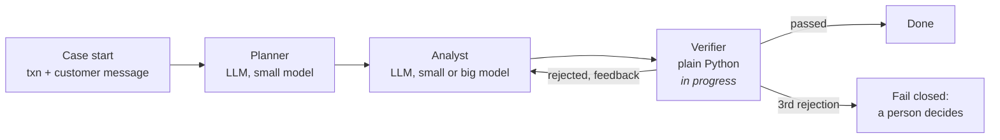

# Card Dispute Triage Agent

A multi-agent LLM system that triages card disputes, built and measured block by block over **2,008,000 seeded synthetic card transactions** with PySpark-engineered features.

A customer disputes a charge and writes a message. The agents read the transaction's features and the message, decide what kind of dispute it is, and back the decision with evidence that plain code can check.

**Stack:** Databricks · PySpark · Delta Lake · LangChain · LangGraph · OpenAI (gpt-4.1-mini / gpt-4.1) · Pydantic · MLflow tracing

## Why this needs an LLM

Rules can score the numbers: velocity, amount, merchant, country change. They can't read the customer's story. *"I never made this, my card was in my wallet"* next to a burst of crypto charges is true fraud. *"My son used my card"* is friendly fraud, even if the velocity flag fired. The deciding evidence is in the customer's words, so the model reads the words and code handles everything that can be computed or checked.

## Cost and latency

Indicative, single case. Measured per call by `call_llm()`, which logs step, model, latency and tokens for every call. Accuracy on a frozen golden set, and run-level p50/p95, come with the evaluation block.

| Step | Model | Tokens (in / out) | Cost | Latency |
|---|---|---|---|---|
| Planner | gpt-4.1-mini | ~500 / ~17 | ~$0.0002 | ~1–2 s |
| Analyst (hard case) | gpt-4.1 | ~680 total | ~$0.0018 | ~1.8 s |

Almost all of the cost is input tokens — prompt plus schema. The answer itself is about 17 tokens, so the cost lever is trimming what gets sent, not shortening what comes back. The big model costs roughly 8× more per call, which is why model routing gets measured in a later block rather than assumed.

## Architecture

The agents never call each other. They share one typed state (`CaseState`), and each agent writes only its own fields:

| Field | Written by |
|---|---|
| `txn_id`, `txn`, `dispute_text` | case start |
| `story_vs_data`, `checks`, `difficulty` | Planner |
| `verdict` (decision, reasons, policies, quotes) | Analyst |
| `feedback`, `attempts`, `status` | Verifier |

## What's here so far

- `generate_transactions.py` → seeded generator: 2,008,000 transactions, 50,000 cards, 30 days, 2,000 planted fraud bursts
- `fraud_triage_agent.ipynb` → features, state contract, agents, tests
- PySpark features → `txn_count_last_10m` and `amt_sum_last_10m` over a 600-second range window per card, `prev_country` via `lag`, one flag per policy, `rules_fired` (0–4)
- Delta feature store → features materialised once to `card_features`; agent lookups are key reads
- `call_llm()` → the single metered entry point: step, model, latency and tokens into `CALL_LOG`; structured output via Pydantic with `strict=True`
- Planner → judges whether the customer's story agrees with the data and which policies apply; code sets difficulty
- Analyst → decides `TRUE_FRAUD` / `FRIENDLY_FRAUD` / `BILLING_ERROR` / `NEEDS_INFO` with reasons, cited policies and exact quotes
- `forks.py` → the strongest alternative implementation at each decision point
- `DECISIONS.md` → every design decision with what was rejected and what would change the choice

## Why the window includes the current row

`rangeBetween(-600, 0)`, not `(-600, -1)`. The feature describes this transaction's position in the burst, so `txn_count_last_10m = 2` means "this is the 2nd transaction in ten minutes", which is what makes `velocity_flag = count > 1` correct.

The bound would be `-1` if this fed a trained model rather than a rule — a row must not be inside its own feature window when you are predicting its label. It is `0` here because the rule is describing the row, not predicting it. Same window function, opposite correct answer, decided by what reads the output.

`rangeBetween` and not `rowsBetween`: range measures over the ordering *value*, so "600" means 600 seconds. `rowsBetween` counts positions, which answers "the last N transactions" regardless of how far apart they are.

## What didn't work

- **Lazy evaluation made every lookup re-run the whole plan.** `transactions_df` with six window functions chained onto it is a plan, not data. Every action re-computed all six windows across 2,008,000 rows, so a single-transaction lookup cost a full pass. Serverless has no `.cache()`. Writing the features once to the Delta table `card_features` turned every subsequent agent lookup into a key read. The materialised table is the feature store — this is the difference between a notebook that demos and one an agent can call per case.

- **The Planner mislabelled a clear case until the field description became directional.** `story_vs_data` has three values — `agrees`, `conflicts`, `unclear` — and the label names alone were not enough: the model could not tell which side of the comparison "agrees" referred to. Rewriting the Pydantic `Field(description=...)` to say explicitly *"the data SUPPORTS the customer's claim"* versus *"the data CONTRADICTS the customer's claim"*, with an example for each value, fixed it. Field descriptions are sent to the provider with the schema, so they function as per-field instructions, not documentation.

- **An unconstrained list invented policy names.** `checks` and `policies` started as `list[str]`. In testing the model returned plausible-sounding entries like *"User verification status"* — not one of the four real policies, and matching no feature flag. That makes the verifier's job impossible: it cannot check a flag that does not exist. Both fields are now `list[Literal[...]]` over the four real policy names, so the provider rejects anything else before it reaches Python.

## What the deterministic verifier cannot do

The verifier checks facts: every cited policy must have actually fired in the features, every quote must appear verbatim in the customer's message, and `TRUE_FRAUD` must cite at least one policy. Those are all mechanically checkable, which is exactly why they are code and not an LLM — a model checking a model is a second thing that can be wrong, and when it fails you get no signal about which one broke.

What it cannot check is whether the *reasoning* is any good. A verdict can cite a real policy, quote the message accurately, and still reach a poor conclusion. That gap is real and deliberate: reason quality belongs in evaluation with an LLM judge and a measured judge error rate, not in the production gate.

## Forks: the alternatives

`forks.py` holds the strongest **alternative** at each decision point, under the same input and output contract as the chosen path. Read with `DECISIONS.md` it shows not only what was built but what the option space was, and what would change the choice.

| Fork | Chosen | Alternative | Switch when |
|---|---|---|---|
| 01 Planner output shape | Pydantic class `Plan` | hand-written JSON Schema dict | no Pydantic support, or the schema is generated at runtime |
| 02 How the node calls the model | structured output, `strict=True` | raw call + `json.loads` | the model or endpoint has no structured-output mode |

## Design decisions

The full list, with what was rejected, is in [DECISIONS.md](DECISIONS.md). The main ones:

- **The state schema is the handoff contract.** Each agent reads and writes fixed fields; no free-text handoff, because free text is unparseable, untestable and has no contract to violate.
- **The LLM judges, code routes.** The model labels the story; `difficulty` is a plain rule, so routing is repeatable and testable.
- **The verifier is deterministic.** Cheap, fast, auditable — which matters in a regulated process.
- **The label is hidden.** `is_fraud_burst` is removed from a copy of the transaction before every prompt and kept in state only for evaluation.
- **Customer text is fenced as data,** so instructions inside a dispute message are not followed.

## Roadmap

- [x] Data generator and PySpark features
- [x] Delta feature store
- [x] Metered LLM wrapper with structured output
- [x] State contract
- [x] Planner
- [x] Analyst
- [ ] Verifier: cited policies must have fired, quotes must appear in the message, fail closed after 3 attempts
- [ ] LangGraph wiring with a conditional retry edge
- [ ] Model routing: cost per run, share escalated, accuracy delta against always-big
- [ ] Memory: card history as episodic memory, measured on and off
- [ ] Second topology (supervisor) compared with the first on cost, latency and accuracy
- [ ] Evaluation: frozen golden set, pass^1 vs pass^3, p50/p95, cost per case
- [ ] FastAPI service: idempotency key, streaming, concurrency limit

## Repository

| File | What |
|---|---|
| `fraud_triage_agent.ipynb` | The notebook: features, state, agents, tests |
| `forks.py` | The alternative implementation at each decision point |
| `generate_transactions.py` | Seeded data generator (Databricks notebook source) |
| `sample_transactions_10k.csv` | ~10,000-row sample; the full table is rebuilt by the generator |
| `DECISIONS.md` | Design decisions: chosen, why, rejected |

## Running it

1. Import this folder into a Databricks workspace as a Git folder (serverless compute works).
2. Create a private notebook named `_config`, outside the repo, that sets `OPENAI_API_KEY`. The notebook loads it with `%run ../../../_config`; adjust the path to where you put it.
3. Run `fraud_triage_agent`. It runs `generate_transactions` first, which builds the `card_transactions` table.

## License

MIT
